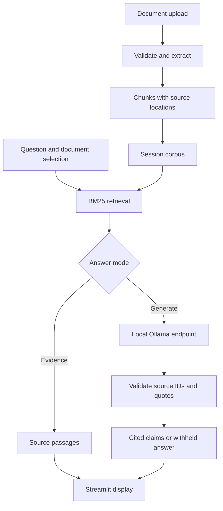

# Architecture at v0.1

The UI is deliberately small. Document parsing, retrieval, and generation live in ordinary Python modules that can later be reused by an API.

## Source identity

Documents receive a SHA-256 content ID. Identical bytes are treated as duplicate content even if a filename changes. Each chunk retains the content ID, display filename, physical PDF page when available, and passage number. Uploaded filenames are never used as write paths. Passage numbers are chunk identifiers, not original paragraph or line numbers.

PDF chunks never span pages. Text and Markdown files have no page numbers. Short paragraphs remain whole; long paragraphs use overlapping character windows. This is a baseline chunker, not a layout-aware parser.

## Retrieval

BM25 uses term frequency, document frequency, and length normalization. Persian/Arabic letter forms and digits are normalized for matching while the original evidence text is preserved. Selected-document IDs filter candidates. This selection is a retrieval filter, not user authentication or an authorization system.

The default mode exposes matching passages directly. A positive retrieval score does not mean the passage answers the question, and the absence of overlap does not prove that the document lacks the answer.

## Optional generation

Retrieved passages get request-scoped identifiers such as `S1`. Ollama receives a system instruction, a standalone question, and the evidence as JSON. Its structured response contains either `not_found` with no claims or short claims with source IDs and quotes.

Before display, the adapter checks the response structure, known source IDs, and whether each quoted text occurs in its source after whitespace normalization. Invalid output is withheld. Semantic support between quote and claim remains an evaluation concern. The model has no tools. Prompt instructions and validation reduce some failure modes but are not a guarantee against prompt injection.

The transport accepts a loopback HTTP endpoint, ignores HTTP proxy settings, rejects redirects, caps response bytes, and times out after 45 seconds. A loopback endpoint can still serve an Ollama cloud model; locality of the model is an operator choice.

## State and deletion

Each browser session owns its in-memory documents and conversation. No uploaded document is written to disk or shared through a global cache. Removing a document clears the conversation; clearing the session also resets the uploader widget. Downloading an export intentionally creates a file for the user.

Extraction currently runs in the UI process. Public uploads need isolated parsing and background jobs. Persistent storage and access control require an explicit design in a later milestone.
